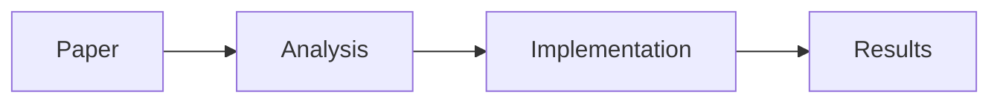

# PaperArxiv 📚

<div align="center">
  
  
  <h3>Your Personal Academic Paper Management System</h3>
  
  [](https://github.com/fuzihaofzh/PaperArxiv/releases)
  [](LICENSE)
  [](https://github.com/fuzihaofzh/PaperArxiv/releases)
  [](https://www.electronjs.org/)
  [](https://vuejs.org/)
  
  [English](README.md) | [简体中文](README_CN.md)
</div>

## 🎯 Overview

PaperArxiv is a modern paper management tool designed to help researchers organize their thoughts and research materials effectively. Unlike traditional reference managers, PaperArxiv emphasizes **note-taking and knowledge organization**, believing that well-structured notes are key to understanding complex research.

## ✨ Features

### 🤖 AI-Powered Features (New!)
- **Ollama Integration**: Automatically extract paper metadata using local AI models
- **Smart Information Extraction**: Title, authors, affiliations, year, journal, and more
- **Intelligent Categorization**: AI suggests relevant tags and library paths
- **Chinese Summary Generation**: Get one-sentence summaries in Chinese

### 📋 Core Features
- **🔍 Auto Extraction**: Automatically extracts metadata from PDF files
- **💾 Portable Storage**: All data stored in one folder - sync with your cloud service
- **🔎 Universal Search**: Powerful search across tags, titles, authors, notes, and content
- **🌳 Advanced Organization**: Hierarchical tree view and flexible tag management
- **📝 Rich Note Support**: Markdown, LaTeX, Mermaid diagrams, and inline images

### 🛠 Technical Improvements (v0.2.0)
- **Modern Tech Stack**: Electron 33.4.11 + Vue 3.5.13 + Element Plus
- **Universal Binary**: Native support for Apple Silicon (M1/M2/M3) and Intel Macs
- **Enhanced Performance**: Optimized search and rendering engine
- **Better UI/UX**: Responsive design with improved visual feedback

## 🚀 Getting Started

### Prerequisites
- **macOS 10.12+** / **Windows 10+** / **Linux**
- **Poppler** (for PDF text extraction)
- **Ollama** (optional, for AI features)

### Installation

1. **Download PaperArxiv**
   - Visit [Releases](https://github.com/fuzihaofzh/PaperArxiv/releases)
   - Download the appropriate version for your platform:
     - macOS: `.dmg` file (Universal or architecture-specific)
     - Windows: `.exe` installer
     - Linux: `.AppImage`, `.deb`, or `.rpm`

2. **Install Poppler**
   ```bash
   # macOS (using Homebrew)
   brew install poppler
   
   # Windows (using Conda)
   conda install -c conda-forge poppler
   
   # Linux (Ubuntu/Debian)
   sudo apt-get install poppler-utils
   
   # Linux (Fedora)
   sudo dnf install poppler-utils
   ```

3. **Install Ollama** (Optional, for AI features)
   ```bash
   # Visit https://ollama.com for installation instructions
   # After installation, pull a model:
   ollama pull gemma3n:latest
   ```

4. **Launch PaperArxiv**
   - macOS: Move to Applications folder and open
   - Windows: Run the installer
   - Linux: Make AppImage executable and run

## 📖 Usage Guide

### Adding Papers
1. Click the **Add** button or drag PDF files into the window
2. PaperArxiv will automatically extract metadata
3. Review and edit the extracted information if needed

### Writing Notes
PaperArxiv supports rich formatting in notes:

```markdown
## Key Contributions
- Novel **encoding method** for repetition reduction
- Mathematical proof of the *upper bound*
- <font color=orange>Important finding</font>

## Formula
$$R \leq \frac{\|B^2\|_*}{\min_{1\leq i \leq n} \{\zeta n - \sum_{j=1}^n (B^2)_{ij}\}}$$

## Workflow


![Figure 1][image-1]

[image-1]:data:image/png;base64,iVBORw0KGgoAAAANS...
```

### Organization
- **Tree View**: Organize papers in hierarchical folders
- **Tags**: Add multiple tags for cross-referencing
- **Search**: Use the search bar to find papers by any field

## 🔧 Development

### Building from Source

```bash
# Clone the repository
git clone https://github.com/fuzihaofzh/PaperArxiv.git
cd PaperArxiv

# Install dependencies
npm install

# Development mode
npm start

# Build for current platform
npm run build

# Platform-specific builds
npm run build:mac-arm64    # macOS Apple Silicon
npm run build:mac-x64      # macOS Intel
npm run build:mac-universal # macOS Universal
npm run build:win          # Windows
npm run build:linux        # Linux
```

### Project Structure
```
PaperArxiv/
├── src/
│   ├── index.js      # Vue application
│   ├── database.js   # SQLite database operations
│   ├── file.js       # PDF processing & AI integration
│   └── utils.js      # Utility functions
├── main.js           # Electron main process
├── index.html        # Application UI
└── package.json      # Dependencies & build config
```

## 🤝 Contributing

We welcome contributions! Please feel free to:
- Report bugs or request features via [Issues](https://github.com/fuzihaofzh/PaperArxiv/issues)
- Submit pull requests for improvements
- Share your usage experience and suggestions

## 📄 License

This project is licensed under the MIT License - see the [LICENSE](LICENSE) file for details.

## 🙏 Acknowledgments

- Built with [Electron](https://www.electronjs.org/), [Vue.js](https://vuejs.org/), and [Element Plus](https://element-plus.org/)
- PDF processing powered by [Poppler](https://poppler.freedesktop.org/)
- AI features powered by [Ollama](https://ollama.com/)
- Icons and visual design inspired by academic research workflow

## 📸 Screenshots

<div align="center">
  
  <p><em>PaperArxiv's clean and intuitive interface</em></p>
</div>

---

<div align="center">
  Made with ❤️ by researchers, for researchers
</div>